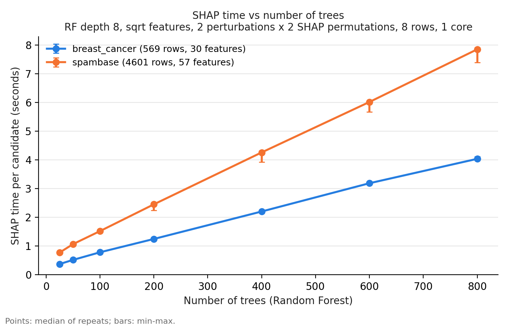
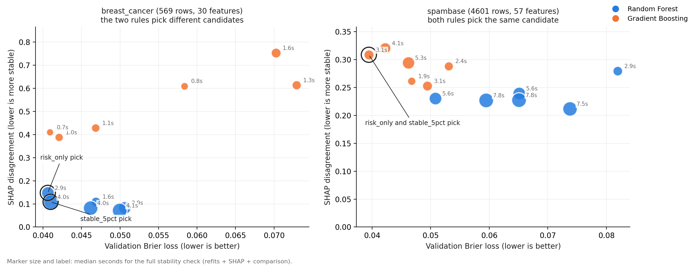

# Experiment 05: Phase 2 cost of an explanation evaluation (Fir)

Answers the three Phase 2 requests from Dania (Nov 2026): a timing breakdown, SHAP time vs number of trees, and cost vs the selection decision, on `breast_cancer` and a second classification dataset with about twice as many features.

All times are **seconds of compute time**, not SHAP values. Stability is `magnitude_disagreement` (lower is more stable).

## Setup
| | |
|---|---|
| Machine | Fir, node fc30561, AMD EPYC 9655, **1 core**, 8 GB; one Slurm job (6241473) for everything |
| Software | Python 3.12.4, scikit-learn 1.8.0, code commit `6bb5a1e` (supervisors' repository) |
| Datasets | breast_cancer: 569 rows, 30 features. spambase (OpenML 44): 4601 rows, 57 features. Both binary classification, staged offline with checksums |
| Fold | outer fold 0 |
| Explanation settings | 2 perturbations (refits), 8 evaluation rows, 4 background rows, 2 SHAP permutations, top-k 3 (same as the pilot) |
| Pool runs (`pool12`) | fixed 12-candidate pool (6 RF + 6 GB, pool seed 4817), **5 repeats** per dataset |
| Tree sweep (`tree_sweep`) | RF only, n_estimators 25, 50, 100, 200, 400, 600, 800; fixed depth 8, sqrt features, leaf 1, standard scaler, median imputer; **3 repeats** per dataset |

Files: `configs/` (dataset registry, pool config), `scripts/phase2_timing.py` (one run), `scripts/phase2_job.sh` (the Slurm job), `scripts/analyze_phase2.py` (table and plots), `results/` (raw outputs of every run, including candidate pools and configs, so the streams can be replayed), `analysis/` (generated tables and plots), `phase2_6241473.log`.

To regenerate the analysis: `python scripts/analyze_phase2.py results analysis` (needs matplotlib).

## Reproducibility
Scores (`candidate_evaluations.csv`) were identical across all repeats for both datasets and both experiments (`analysis/reproducibility.csv`). Only the timings vary between repeats.

## 1. Timing breakdown
Full table: [`analysis/timing_breakdown.md`](analysis/timing_breakdown.md). Selection stage, median over all candidates of a family and all 5 repeats:

| Dataset | Family | Risk fits | Stability refits | SHAP | Comparison | **One stability evaluation** |
|---|---|---|---|---|---|---|
| breast_cancer | RF | 0.72 | 0.72 | 2.58 | 0.001 | **3.47** |
| breast_cancer | GB | 0.44 | 0.66 | 0.24 | 0.001 | **1.04** |
| spambase | RF | 1.01 | 1.28 | 5.15 | 0.001 | **7.01** |
| spambase | GB | 1.59 | 2.44 | 0.55 | 0.001 | **3.10** |

- For RF, SHAP is most of the cost of a stability evaluation (about 75%). For GB, the **refits** cost more than SHAP.
- RF SHAP took about 11x (breast_cancer) and 9x (spambase) longer than GB SHAP, but the whole stability evaluation only about 3.3x and 2.3x, because refits cost about the same or more for GB.
- From breast_cancer to spambase, SHAP time roughly doubled for both families (RF 2.0x, GB 2.3x), while GB's refits grew 3.7x. The comparison step is negligible.
- Final-stage (holdout) timings are reported separately in the full table.

## 2. SHAP time vs number of trees

- SHAP time grows close to linearly with the number of trees on both datasets (breast_cancer about 0.0047 s per tree, spambase about 0.0091 s per tree).
- At every tree count, spambase took about 1.9-2.1x as long as breast_cancer. One SHAP permutation evaluates the model once per feature plus one, and (57+1)/(30+1) = 1.87, so the difference is consistent with the feature count. Spambase also has more rows, so this is consistent with, not proof of, a feature effect; the number of explained rows (8) and background rows (4) was the same for both datasets.
- Repeats were tight (bars are min-max of 3 repeats).

## 3. Cost and the selection decision

- **breast_cancer: the rules pick different candidates.** risk_only picks RF `99c56a33fdd7` (Brier 0.04063, disagreement 0.148, stability check 2.9 s). stable_5pct picks RF `df617ef7fa25` (Brier 0.04099, disagreement 0.109, 4.0 s). That is about 0.9% higher loss for 26% lower disagreement, and its stability check took about 38% longer.
- **spambase: both rules pick the same candidate**, GB `bcffaa662a54` (Brier 0.03945, disagreement 0.309, 3.1 s). The 5% threshold was 0.0414 and no other candidate was within it. The more stable candidates were RF (disagreement 0.21-0.28) but had at least 29% higher loss, so stability could not change the choice. On this dataset, the stability evaluations of all other candidates did not affect the decision.
- The most expensive stability checks (RF with 600 trees, about 7.5-7.8 s on spambase) were for candidates that were never close to being selected. This is the cost that a budget-allocation strategy could avoid.

## Limitations
- One outer fold and smoke-level explanation settings; absolute times will be larger with more refits, rows or permutations.
- The two datasets differ in rows as well as features, so differences cannot be attributed to feature count alone.
- The tree sweep covers RF only, at one depth.
- The 12-candidate pool lists all RF before GB; it is a fixed pool, not an interleaved search.
- The timing scripts were written with ChatGPT's help and reuse the supervisors' functions; call counts and identical scores are checks, not a dedicated test.
