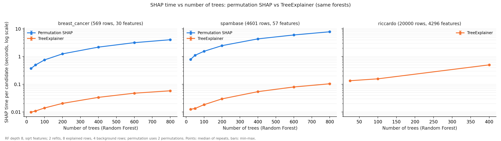

# Experiment 06: Permutation SHAP vs TreeExplainer on the same random forests

**Status:** breast_cancer and spambase are complete. For riccardo, the TreeExplainer runs are complete and the permutation SHAP runs are still going (job 6784482, which I expect to stop at its 12-hour limit). I will update the riccardo permutation rows when it ends.

In our November meeting, Dania asked me to compare permutation SHAP and TreeExplainer on the same fitted random forests, including the riccardo dataset, keeping the evaluation rows, background and prediction scale the same. I report the SHAP time, the total stability-evaluation time, and whether the stability ranking or the selected model changes.

All times are **seconds of compute time**. Disagreement = `magnitude_disagreement` (lower = more stable); rank 1 = most stable.

## What I changed and what I kept the same
- **I changed only the SHAP function.** With `--explainer tree`, my script `scripts/shap_timing.py` replaces the supervisors' `permutation_shap_values` with a function that takes the same inputs and returns the same output shape, computed with `shap.TreeExplainer`. Everything else (seeds, splits, refits, comparison, selectors) is the supervisors' code, unchanged. I wrote the scripts with help from an AI assistant (Claude) and ran all the experiments myself on Fir.
- **Same fitted forests:** I used the same seeds, so the forests are identical for both explainers. As a check, the predictive risk was identical for every candidate under both explainers.
- **Same evaluation rows (8), background rows (4) and prediction scale** (probability of class 1, as returned by `predict_for_attribution`). I run TreeExplainer on the forest after the pipeline's preprocessing (imputer and scaler), which keeps one column per input feature for these all-numeric datasets.
- **Feature dependence:** both explainers use *interventional* SHAP: a feature is switched to the explained row's value independently of the others, so correlated features can be combined in unrealistic ways. The permutation estimator does this by construction; I set TreeExplainer to `feature_perturbation="interventional"` to match. TreeExplainer's alternative mode, *tree path dependent*, follows the training data's paths through the trees and so partly respects correlations between features; I did **not** use it, so that both methods compute the same quantity.
- **Exact vs estimated:** TreeExplainer computes these Shapley values exactly for the given background rows. Permutation SHAP estimates them from random feature orders (2 per refit here).

## Sanity check (`scripts/check_tree_vs_permutation.py`)
Before comparing speed, I checked that both methods measure the same thing, using one 200-tree RF on breast_cancer:
- **Additivity:** TreeExplainer values summed to f(x) minus the mean background prediction, with a maximum error of 6e-9.
- **Convergence:** permutation SHAP approached the TreeExplainer values as permutations increased (mean absolute difference 0.0119 with 2, 0.0050 with 10, 0.0019 with 50, 0.0014 with 150 permutations). Both methods therefore estimate the same quantity. With 2 permutations the error is close to the size of a typical SHAP value (0.015), so estimation noise contributes to the measured disagreement.
- TreeExplainer took 0.035 s; permutation SHAP with 2 permutations took 1.44 s.

## Setup
| | |
|---|---|
| Pool | the same 6 Random Forest candidates as experiments 03-05 (`configs/rf_pool6.yaml`, pool seed 4817) |
| Tree sweep | RF with 25-800 trees (riccardo: 25, 100, 400), depth 8, sqrt features, leaf 1, standard scaler, median imputer |
| Explanation settings | 2 refits, 8 evaluation rows, 4 background rows, 2 permutations (permutation SHAP only), outer fold 0 |
| breast_cancer / spambase | job 6784481, node fc30554, AMD EPYC 9655, 1 core; 3 repeats of pool and sweep per explainer |
| riccardo (20,000 rows, 4,296 features; OpenML task 168338) | job 6784482, node fb21808, AMD EPYC 9654, 1 core, 32 GB; 1 repeat |
| Software | Python 3.12.4, scikit-learn 1.8.0, shap 0.54.1, supervisors' code commit `6bb5a1e` |

I saved the raw results of every run (candidate pools, configs, timings) in `results/`. The tables and plot can be regenerated with `python scripts/analyze_exp06.py results analysis`. I compare timings only within a job (the two jobs ran on different CPU models).

## Results
Full tables per dataset: [`analysis/comparison.md`](analysis/comparison.md).

### SHAP time and total stability time (selection stage, medians)
| Dataset | SHAP per candidate, permutation | SHAP per candidate, TreeExplainer | SHAP speed-up | Stability check, permutation | Stability check, TreeExplainer |
|---|---|---|---|---|---|
| breast_cancer (569 rows, 30 features) | 1.3-3.2 s | 0.02-0.04 s | 63-77x | 1.6-4.1 s | 0.4-1.2 s |
| spambase (4,601 rows, 57 features) | 2.4-6.1 s | 0.02-0.09 s | 60-127x | 2.9-7.8 s | 0.6-1.9 s |
| riccardo (20,000 rows, 4,296 features) | 4,087 s (1 of 6 candidates finished so far) | 0.17-0.53 s | about 24,000x (200-tree RF) | 4,106 s (1 candidate) | 16-237 s |

### Ranking and selection
| Dataset | Stability ranking the same? | risk_only | stable_5pct | knee |
|---|---|---|---|---|
| breast_cancer | No (ranks change for most candidates) | same | same | same |
| spambase | No | same | same | **different** (permutation: d35d29df0546, TreeExplainer: 99c56a33fdd7) |
| riccardo | pending (permutation incomplete) | TreeExplainer: 99c56a33fdd7 | TreeExplainer: d35d29df0546 | TreeExplainer: d35d29df0546 |

### SHAP time vs number of trees

## What I found
1. **TreeExplainer was about 60-130x faster** than permutation SHAP on breast_cancer and spambase, and about 24,000x faster on riccardo for the one candidate permutation SHAP has finished (0.17 s vs 4,087 s).
2. **SHAP time still grows with the number of trees under TreeExplainer**, so part of the cost comes from the model (more trees to traverse), not only from the SHAP method.
3. **Feature count matters much less for TreeExplainer.** riccardo has about 140x the features of breast_cancer, but at 400 trees its TreeExplainer time was about 15x higher (0.50 s vs 0.034 s). Under permutation SHAP, spambase (1.9x features) was about 2x slower than breast_cancer.
4. **With TreeExplainer, the stability check is dominated by refitting**, not SHAP (on riccardo, 16-237 s of refits vs under 1 s of SHAP).
5. **Disagreement was generally lower with TreeExplainer**, strongly on spambase (0.21-0.28 with permutation vs 0.05-0.10). This is consistent with part of the permutation-based disagreement being estimation noise from 2 permutations.
6. **The stability ranking changed** on both complete datasets. The risk_only and stable_5pct choices were the same; the knee choice changed on spambase. On riccardo (TreeExplainer), stable_5pct chose a different candidate from risk_only.

## Limitations of what I did
- One outer fold, 2 refits, 8 evaluation rows and 4 background rows; riccardo has one repeat.
- I used 2 permutations for permutation SHAP, matching my earlier experiments; more permutations would reduce its noise but multiply its cost.
- I tested Random Forest only. TreeExplainer applies to tree models; the MLP family would still need a model-agnostic method.
- The two jobs ran on different CPU models, so I compare times within a job only.
